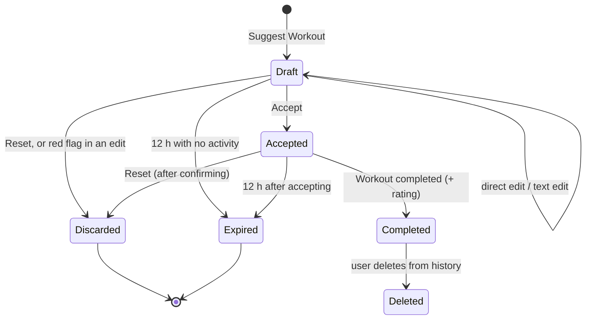
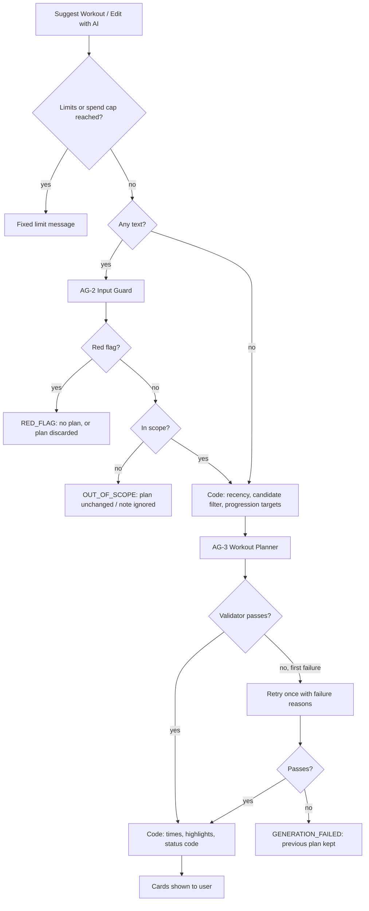

# Gym Coach — Product Requirements Document (MVP)

| | |
|-|-|
| **Product** | Gym Coach |
| **Version** | 1.3 (2026-10-28) — equipment master list grows to 62 items found by analysing every exercise, with a list of items assumed available everywhere (D-53). 1.2 (2026-10-27) — newbies get the full sets range when the minimum can't fill a session (D-49); sessions the available exercises can't fill are allowed shorter, with `SHORT_SESSION` (D-50, FR-44); drops the "never add rehab exercises" health-adjustment rule and its EV-4 check (D-51); cardio for every goal when the coach chooses the focus, limited for Build muscle and Stay fit (D-52). 1.1 — UI labels and placements from the owner-approved Claude Design handoff (2026-10-25). No behaviour changes. 1.0 was approved by the owner on 2026-10-24. |
| **Design** | `docs/design/handoff/README.md` defines layout, look and feel. If it disagrees with this document on behaviour, this document wins. |
| **Author / owner** | Deepak Baid |
| **Date** | 2026-10-23 |
| **Readers** | The owner (review and decisions); a coding agent (technical design and build) |
| **Supersedes** | `capstone-qna.md`, wherever the two differ (see Appendix D) |

**For the coding agent:** "must" marks a requirement. IDs (`FR-`, `AG-`, `EV-`) are stable, so refer to them in code, tests and commits. Technical choices this document does not make are yours, within the constraints in section 12. Section 14.2 lists assumptions made while drafting, which the owner has since confirmed. They are part of the spec; flag any you cannot meet.

---

## 1. Overview

Gym Coach is a phone-first web app where an AI coach builds each day's workout from three things: the time you have, the equipment you can use, and what you have trained recently. You stay in control of every change.

In the MVP, a user:

1. Signs up and sets up a profile once: goal, experience, workout days per week and equipment (picked from a list or detected from gym photos).
2. Opens the planner, chooses 30, 45 or 60 minutes, picks muscle groups or lets the coach choose, and can add a short note about today (e.g., "knee is sore", "only dumbbells today").
3. Gets a workout as structured cards: a warm-up, exercises with sets and reps or timed sets, a cool-down, and the total time.
4. Adjusts it directly on the cards or with a short text request, or resets and starts over.
5. Accepts it, trains, then marks it completed and rates how hard it felt.
6. Gets better plans over time, because the coach uses completed history to pick the next focus and to progress exercises.

Gym Coach is for the owner and up to 20 friends. It is not a commercial product. Market, competition and monetization are out of scope (section 15).

---

## 2. Problem and context

### 2.1 Current workflow
1. The user decides to work out on a given day.
2. They think about how much time they have, but their plan is not reliably built around it.
3. They look for ideas in an LLM chat, on YouTube or in a fitness app, or decide as they go in the gym.
4. They put together a rough plan, or pick exercises during the session.
5. They follow or adjust it without any system that accounts for their equipment, their history or the muscles they trained recently.
6. They repeat this every time they work out.

### 2.2 Where it breaks
- **Planning takes time before every workout** and still produces a mediocre plan.
- **Equipment mismatch:** plans include exercises the user can't do, so they skip them or make random substitutions.
- **Time mismatch:** plans don't fit the time available, so they run too long or are poorly structured.
- **No memory:** recently trained muscles get trained again, and there's no progression from one session to the next.

### 2.3 Why an agent rather than a static AI feature
- **It remembers across sessions.** Equipment and completed workouts carry forward. The user only provides today's time and, optionally, a focus or a note.
- **It chooses the focus from recent training** and progresses exercises based on completed workouts and how hard they felt.
- **It adapts to today's conditions** (soreness, tiredness, limited equipment) and to change requests.
- **It is safe by construction.** The LLM makes the judgment calls, while code enforces the facts: which exercises exist, what equipment is available, timing and progression numbers (section 8.1).

---

## 3. Users

### 3.1 Primary persona
A casual, fairly inexperienced fitness enthusiast with no coach or trainer. They want to work out regularly and need help deciding what to do in each session. They have access to a gym or home equipment, and their training frequency is often irregular.

### 3.2 Pilot group
- The owner plus friends, **20 users at most**, with mixed experience levels.
- Mostly used **on a phone, in the gym**.
- Metric units. Nothing in the MVP displays units, since there are no weights and no body measurements.

### 3.3 Not designed for
- People who need injury rehabilitation, or medical or clinical exercise guidance.
- Competitive or performance athletes who need periodized programming.
- People looking for nutrition, supplement or diet advice.

---

## 4. Goals and non-goals

### 4.1 Goals
1. **Cut planning time.** Go from opening the planner to an accepted plan in about 2 minutes.
2. **Make plans doable.** Every exercise matches the user's equipment, the selected focus and the time available.
3. **Use history.** The coach avoids recently trained muscles, keeps exercises consistent from one session to the next, and progresses them based on completed workouts and difficulty ratings.
4. **Keep the user in control.** Every plan is reviewed, edited, accepted or reset by the user. Nothing is logged unless the user marks it completed.
5. **Stay safe and on-topic.** Adapt to minor discomfort, stop on red flags, and never drift into conversation.

### 4.2 Non-goals for the MVP
Each of these is parked for a future build (section 15):
- Nutrition, supplement or diet advice
- Injury or rehab advice
- Weekly programs or calendar scheduling
- Reminders or notifications
- Social features
- Wearables integration
- Video form-checking
- Multiple languages
- Suggesting weights (kg)
- Per-exercise logging (done as planned, skipping exercises, actual sets, reps or time)
- Logging workouts done outside the app
- Google sign-in
- Progress charts
- An in-workout mode (ticking off sets, rest timer)
- Supersets or circuits
- Remembering preferences from text feedback
- Remembering health information between sessions
- Any commercial features

---

## 5. Success metrics

Treat these as directional: with 20 users or fewer, the numbers will be noisy. The owner reviews them weekly during the pilot (section 13).

| Type | Metric | Definition | Target |
|-|-|-|-|
| **Main metric** | Retained trainers | % of users who complete ≥1 workout in each of their weeks 2, 3 and 4 after sign-up | **≥ 60%** |
| Supporting | Plans accepted first time | % of generated plans accepted with no Reset | ≥ 60% |
| Supporting | Edits before accepting | Median number of text edits per accepted plan | ≤ 3 |
| Supporting | Time to plan | Median time from opening the planner to accepting | ≤ 2 min |
| Guardrail | Safety misses | Known cases where a red flag wasn't caught, or out-of-scope input changed a plan | 0 |
| Guardrail | Plan failures | % of generations that still fail validation after the retry | ≤ 10% |
| Guardrail | Cost | LLM spend on real usage | ≤ $60 / month (section 12.4) |
| Guardrail | Speed | Time to generate a plan or apply an edit | ≤ 10 s typical (p50), ≤ 20 s p95 |

---

## 6. User journeys

### 6.1 Sign-up and onboarding (once)
1. The user signs up with email and password and sees the sign-up notice (Appendix A, `SIGNUP_NOTICE`).
2. They verify their email through a link, then log in.
3. They create a profile:
   - name
   - fitness goal: *Build muscle / Lose weight / Stay fit*
   - experience: *Newbie / Moderately regular / Experienced*
   - planned workout days per week: 1–7
4. **Equipment.** Every item in the equipment list starts out selected. The user can:
   - unselect or select items in the list, or
   - upload gym photos. The detected equipment replaces the "all selected" default, and the user reviews and confirms it.
5. They save the profile and land on the planner.

### 6.2 Planning today's workout
1. The planner shows:
   - **Session length:** 30 / 45 / 60 minutes. The default is 45 for the first session, then whatever the user chose last.
   - **Focus:** "Let coach choose" is selected by default every time. The user can instead multi-select from Chest, Back, Shoulders, Biceps, Triceps, Legs, Core and Cardio, with no limit on how many.
   - **Recency strip:** a fixed-format line such as "Last trained: Legs 2 days ago · Chest 4 days ago".
   - **"Anything for today?"**: an optional note of up to 300 characters, e.g., "knee is sore", "only dumbbells today", "slept badly".
2. The user taps **Suggest Workout** and gets plan cards with a header showing the focus and a fixed-format reason (e.g., "Coach picked Back & Biceps — rested at least 6 days").

### 6.3 Reviewing and changing the plan
- **Direct edits on the cards:** each exercise card has a controls button that opens that card's controls, one card at a time. With them the user can change sets, reps or time per set, delete the exercise, or reorder it. Tapping the card itself opens how-to (FR-43). The total time updates as they edit. If it goes over the session length, a soft warning appears.
- **Text edit:** tap **Edit with AI** and type a request of up to 300 characters, e.g., "swap squats for lunges", "fewer exercises", "my wrist hurts". The coach updates the cards, changed cards are highlighted, and a fixed status message appears. There are at most 5 text edits per workout.
- **Reset:** the Reset button sits next to the plan's Draft or Accepted tag. It discards the plan and all changes. The user can pick an optional reason: *Too long / Too hard / Too easy / Don't like the exercises*. The "Anything for today?" box is cleared, while the session length and focus stay selected. The next plan will be clearly different.

### 6.4 Accept, train, complete
1. **Accept** turns the plan into the active workout. It is saved on the server, so the user can plan at home and open it at the gym. It expires 12 hours after it was accepted.
2. After training, the user taps **Workout completed** and picks one difficulty rating for the whole workout: *Easy / Just right / Hard*. That's all: the MVP has no per-exercise logging, so no skipping exercises or editing what was done (parked, section 15).
3. The workout is saved to history. The user can plan another workout the same day.

### 6.5 History and profile
- **History list:** date, focus, length, exercises with their sets, reps or time as accepted, and the rating. The user can delete an entry but not edit it.
- **Profile:** every field and the equipment can be edited at any time, and the user can delete their account and all of its data.

### 6.6 Plan lifecycle

Only **Completed** workouts are saved as history and used for planning.

---

## 7. Functional requirements

Everything in this section is in MVP scope.

### 7.1 Accounts and access
- **FR-1 Sign-up.** Open sign-up with email and password. Accounts must verify their email through a link before they can log in.
- **FR-2 Password reset** through an email link.
- **FR-3 Sign-up notice.** The `SIGNUP_NOTICE` text (Appendix A) must be shown at sign-up.
- **FR-4 Account deletion** removes the profile, equipment, plans and history right away. Logs expire within 30 days (FR-6).
- **FR-5 Data isolation.** Users can only read and write their own data.
- **FR-6 Logs.** Agent call logs are kept for 30 days and then deleted automatically (section 12.6).

### 7.2 Onboarding and profile
- **FR-10** The profile captures:
  - name (text)
  - goal: Build muscle / Lose weight / Stay fit
  - experience: Newbie / Moderately regular / Experienced
  - planned days per week (1–7)
  - equipment

  The MVP must not collect age, sex, height or weight.
- **FR-11** Every profile field can be edited at any time, and the next generation uses the latest values.
- **FR-12** The app stores the last session length the user chose and uses it as the default.

### 7.3 Equipment
- **FR-20** The equipment list comes from the equipment master table (section 10.2). In a new profile, every active item starts out selected.
- **FR-21 Photo detection.** The user uploads up to 5 photos at a time (one scan), e.g., of different parts of the gym. The photo picker doesn't allow more than 5. The Equipment Vision agent (AG-1) analyzes them together and returns one combined, de-duplicated list of items from the master list. Only items above the confidence threshold are shown:
  - During onboarding, the detected items replace the default selection.
  - When editing the profile later, they are added to the current selection.
  - The user must confirm or edit the list before it is saved.
- **FR-22** Detected equipment that isn't on the master list is never shown.
- **FR-23** Some items detected → show them with `PHOTO_PARTIAL`. Nothing detected confidently → show `PHOTO_NONE` and leave the selection unchanged.
- **FR-24** Photos are deleted as soon as analysis finishes and are never stored with the profile.
- **FR-25** Bodyweight exercises are always allowed, whatever equipment is selected.

### 7.4 Planner inputs
- **FR-30 Session length.** 30, 45 or 60 minutes. This includes a 5-minute warm-up and a 5-minute cool-down.
- **FR-31 Focus.** "Let coach choose" is the default every session. Alternatively the user can pick any number of: Chest, Back, Shoulders, Biceps, Triceps, Legs, Core, Cardio. Choosing groups unselects "Let coach choose".
- **FR-32 Recency strip.** Computed by code, not the LLM. It lists the groups trained in the last 14 days, most recent first, e.g., "Last trained: Legs 2 days ago · Chest 4 days ago". With no history it reads "No workouts logged yet". Day labels are "today", "yesterday" and "N days ago".
- **FR-33 "Anything for today?"** An optional note, up to 300 characters. It is handled under section 8.11 and only applies to the current planning session.

### 7.5 Plan generation and cards
- **FR-40** **Suggest Workout** produces a plan through the pipeline in section 8.4.
- **FR-41 Card types.** There are exactly three:

  | Card | Shows | Used for |
  |-|-|-|
  | **Reps** | Exercise name · sets · reps per set · total time | Strength exercises |
  | **Timed** | Exercise name · sets · time per set · total time | Holds (plank), continuous cardio (treadmill shown as 1 × 10 min) |
  | **Activity** | Activity name · time | Warm-up and cool-down (5 min each) |

  Cards must not show rest, weight, intensity, speed or incline.
- **FR-42** Every plan starts with a warm-up card and ends with a cool-down card. Each is a fixed routine taken from the database and matched to the focus (section 10.5).
- **FR-43** Tapping a card shows how to do it: the instructions and image from the exercise database, or the list of moves for a warm-up or cool-down routine. This text comes from the database and is never written by the LLM.
- **FR-44 Time.** Code calculates total time (section 8.8). A plan's total must fall between **85% and 100%** of the session length. Exception (D-50): when the available exercises can't fill the session, the plan may be shorter, must reach 85% of what they allow, and shows `SHORT_SESSION`.
- **FR-45 Plan header.** Shows the focus and a fixed-format reason (Appendix A): one wording when the user picked the groups, another when the coach picked based on recency, and another for a first workout.
- **FR-46** The app never shows text written by an agent. All messages come from the fixed catalog in Appendix A.

### 7.6 Changing a plan
- **FR-50 Direct edits** on a draft plan: change sets, reps or time per set, delete an exercise, reorder. These don't call the LLM. The total time updates immediately, and `OVER_TIME_WARNING` appears if the total goes over the session length, but the edit is still allowed.
- **FR-51 Text edits** go through **Edit with AI**: up to 300 characters, at most **5 per workout**. When the limit is reached, show `EDIT_LIMIT`.
- **FR-52** After a text edit, show one fixed status message (Appendix A) and highlight cards that were added or changed. Code compares the old and new plans to find them.
- **FR-53** A text edit must keep the user's earlier direct edits, unless the request is specifically about those items.
- **FR-54** Text that is out of scope or can't be understood leaves the plan exactly as it was (section 8.11).

### 7.7 Reset
- **FR-55 Reset** discards the current plan, all edits and the "Anything for today?" note. The session length and focus selections stay.
- **FR-56** Reset offers optional one-tap reasons: *Too long / Too hard / Too easy / Don't like the exercises*. The chosen reason and the discarded plan inform the next generation in the same planning session only.
- **FR-57** The first plan generated after a Reset must change at least half of the main exercises compared with the discarded plan.
- **FR-58** Reset is available until the workout is completed. Resetting an accepted workout asks for confirmation first (`DISCARD_CONFIRM`). The confirmation and the optional reasons appear together in one dialog.

### 7.8 Accept, expiry, completion
- **FR-61 Accept** locks the plan: no more direct or text edits, and only Reset or Complete are available. Plans are saved on the server and survive closing the app.
- **FR-62 One active plan at a time.** A user can have at most one draft or accepted plan. To plan another, they must complete or reset the current one.
- **FR-63 Expiry.**
  - An accepted workout expires 12 hours after it was accepted.
  - A draft expires 12 hours after its last change.
  - Expired plans show `EXPIRED` and are never saved to history.
- **FR-64 Completion.** **Workout completed** asks for one required difficulty rating for the whole workout: *Easy / Just right / Hard*. The MVP doesn't record per-exercise results (done as planned, skipped exercises, actual sets, reps or time).
- **FR-65** A completed workout is saved as the final version the user accepted, including any direct edits, with the difficulty rating. No backdating.
- **FR-66** More than one workout per day is allowed, one at a time (FR-62).

### 7.9 History
- **FR-70 History list.** Shows date, focus, length, each exercise with its sets, reps or time as accepted, and the rating, newest first.
- **FR-71** Users can delete an entry but not edit it. Deleted entries are no longer used for planning.
- **FR-72** Only completed workouts appear in history. Drafts, discarded, expired and accepted-but-not-completed plans never do.

### 7.10 Limits
All limits reset at midnight in the user's local time zone.

- **FR-80** Up to 10 plan generations per user per day. This counts Suggest Workout, including after a Reset, but not automatic retries or text edits. When reached, show `PLAN_LIMIT`.
- **FR-81** Up to 5 photo scans per user per day, each of up to 5 photos (FR-21). When reached, show `PHOTO_LIMIT`.
- **FR-82** Up to 5 text edits per workout (FR-51).
- **FR-83** When the production LLM spend cap is reached, the app shows `SPEND_CAP` and doesn't make any LLM calls (section 12.4).

---

## 8. Agent design

### 8.1 Design principles
1. **The LLM makes the choices; code enforces the facts.** The LLM picks the focus and exercises and interprets requests. Code decides which exercises exist and are allowed, calculates time and progression numbers, and validates every plan.
2. **No free text, in or out.** The Planner never sees what the user typed; it only receives structured requests from the Input Guard. The app never shows text an agent wrote, only fixed messages.
3. **Everything is structured.** Each agent call returns schema-validated output.
4. **Fail safe.** When something is unclear, leave the plan unchanged and show a fixed message. When a health input is ambiguous, treat it as a red flag (section 8.11).
5. **The user decides.** Agents propose; only the user can confirm equipment, accept a plan or log a workout.

### 8.2 Agents and components

**LLM agents.** None of them can write to the database or take actions directly.

| ID | Agent | Model | Job | Output |
|-|-|-|-|-|
| **AG-1** | Equipment Vision | Claude Sonnet 5.5 | Identify gym equipment across the photos in one scan (up to 5) | One combined list of `{equipment_id, confidence}` from the master list |
| **AG-2** | Input Guard | Claude Haiku 5.5 | Sort the "Anything for today?" note or an Edit with AI request into categories, detect red flags, and turn it into structured requests | `{category, red_flag, intents[]}` (section 8.11) |
| **AG-3** | Workout Planner | Claude Sonnet 5.5 | Pick the focus (when the coach chooses) and the exercises, sets, reps and times; apply requests to an existing plan | Plan JSON (section 8.5) |

**Code components (no LLM):**

| Component | Responsibility |
|-|-|
| Orchestrator | Runs the flow in section 8.4. It is the only component that calls agents or writes to the database. |
| Limits and spend guard | Enforces FR-80 to FR-83. |
| Recency calculator | Days since each muscle group was trained, the recency strip, and actual training frequency over 14 days. |
| Candidate filter | Builds the list of exercises the Planner may use, filtered by equipment, experience level, body areas to avoid, focus and the 48-hour rule. |
| Progression engine | Calculates target sets, reps and times for exercises the user has done before (section 8.9). |
| Time calculator | Calculates card and plan totals (section 8.8). |
| Plan validator | Checks every plan against the rules in section 8.13, and triggers the retry or the failure message. |
| Message mapper | Turns status codes into the fixed messages in Appendix A and highlights changed cards. |

### 8.3 Agent loop (observe → decide → act → check)

| Step | What happens | Who does it |
|-|-|-|
| **Observe** | Profile, equipment (or today's override), completed history with ratings, recency, session length, focus, structured requests from today's note or an edit, and, after a Reset, the discarded plan and the reason | Code assembles it; AG-2 turns text into structured requests, which code passes to AG-3 |
| **Decide** | Focus (when the coach chooses), which exercises to keep for continuity, which to add or swap, the order, how to adapt to health or equipment requests | AG-3 |
| **Act** | A structured plan: exercise IDs, card types, sets, reps or time per set, warm-up and cool-down routine IDs | AG-3 output, with times calculated by code |
| **Check** | The rules in section 8.13; one retry with the failure reasons; otherwise a fixed error | Plan validator |
| **Hand back** | Cards and a fixed status message, then the user reviews, edits, resets or accepts | App + user |

### 8.4 Generation and edit flow

**Suggest Workout:**
1. Check the limits and spend cap.
2. If there is a note, run AG-2 on it:
   - Red flag → show `RED_FLAG` and stop.
   - Out of scope → generate as normal, ignoring the note, and show `OUT_OF_SCOPE_NOTE`.
   - Not understood → generate as normal and show `NOT_UNDERSTOOD_NOTE`.
3. Code computes recency, the candidate list and progression targets.
4. AG-3 generates a plan, the validator checks it, and code calculates the times.

**Edit with AI:**
1. Check the edit limit and the spend cap.
2. Run AG-2 on the text:
   - Red flag → discard the draft and show `RED_FLAG`.
   - Out of scope → leave the plan unchanged and show `OUT_OF_SCOPE_EDIT`.
   - Not understood → leave the plan unchanged and show `NOT_UNDERSTOOD`.
3. Otherwise, AG-3 runs in edit mode with the current plan (including direct edits) and the structured requests.
4. The validator checks the result, then the highlights and status are shown.

### 8.5 What each agent receives

| Agent | Receives | Never receives |
|-|-|-|
| AG-1 | Up to 5 photos from one scan; the equipment master list (IDs and names) | User profile, history |
| AG-2 | The user's text (≤ 300 characters); the current plan's exercise IDs and names; the equipment master list; the 8 muscle groups; the list of body areas | Profile details, history |
| AG-3 | Profile (goal, experience); session length; focus or "coach chooses"; the candidate list (IDs, names, muscle group, card type, level, compound/isolation); progression targets; recency and actual frequency; a short summary of recent completed workouts; **AG-2's output**: the structured requests (`intents[]`) from today's note or the edit, already mapped to the app's own names and IDs; after a Reset, the discarded plan's IDs and the reason; the training rulebook (section 8.8) | **What the user typed**, name, email, photos |

**AG-3 output (structured):** `focus_groups[]`, `focus_reason` (`user_selected` / `coach_recency` / `coach_first_workout`), `warmup_routine_id`, `cooldown_routine_id`, `items[]` (each `{exercise_id, card_type, sets, reps | time_per_set_s}`), `applied_intents[]`, and `unapplied_intents[]` (each `{intent_id, reason: not_available | time}`, where `not_available` means no matching exercise in the candidate list). Code works out the status code from the applied and unapplied intents.

### 8.6 Tools and permissions
- Agents have **no tools** and **no write access**. Each is a single structured call made by the orchestrator. There is no open-ended agent loop.
- Only the orchestrator reads or writes:
  - profile and equipment
  - plans
  - completed history
  - usage counters
  - logs
- The orchestrator writes history **only** when the user completes a workout.

### 8.7 Grounding strategy

| Grounding source | What it constrains |
|-|-|
| **Exercise database** (free-exercise-db plus our columns, section 10.1) | The only source of exercises, how-to text and images. AG-3 can only use IDs from the candidate list. |
| **Equipment master list** (section 10.2) | The only equipment AG-1 can report or AG-2 can reference. |
| **Candidate list** (built by code for each request) | Exercises allowed for this user today: equipment, level, body areas to avoid, focus, 48-hour rule. |
| **Training rulebook** (section 8.8) | Sets and reps by goal, levels by experience, starting hold times, order, time window. |
| **Progression engine** (section 8.9) | Numbers for exercises the user has done before. |
| **Completed history** | Recency, frequency, continuity, progression. |
| **Body-area tags** (section 10.4) | Health adaptation is a database lookup, not LLM judgment. |

The LLM's own fitness knowledge is used only to choose and order exercises among valid candidates. It never decides what exists, what is available, what is safe for a body area, or the numbers for exercises the user has done before.

### 8.8 Training rulebook (v1)
Loosely based on public strength-training guidance from the ACSM (American College of Sports Medicine). The owner reviews and approves it, and it is versioned with the prompts.

| Rule | Value |
|-|-|
| Sets × reps by goal | Build muscle **3–4 × 8–12** · Lose weight **2–3 × 12–15** · Stay fit **2–3 × 10–15** |
| Exercise level by experience | Newbie: *beginner* only · Moderately regular: *beginner + intermediate* · Experienced: all levels |
| Volume by experience | Newbies stay at the low end of the sets range |
| Starting hold time (timed holds) | Newbie 20 s · Moderately regular 30 s · Experienced 45 s |
| Order | Warm-up → compound exercises → isolation exercises → cardio (if any) → cool-down |
| Warm-up / cool-down | 5 min each, always included, counted within the session length |
| Time window | Plan total between 85% and 100% of the session length |
| Continuity | When there is a completed workout with an overlapping focus, keep about half of its exercises (checked by the LLM judge, not the validator) |
| After a Reset | At least half of the main exercises differ from the discarded plan (validator check). *Too long* → aim near the 85% lower bound with fewer exercises · *Too hard* → lighter volume or easier versions · *Too easy* → more volume or harder versions · *Don't like the exercises* → different exercises |
| Cardio (when the coach chooses the focus) | Any goal may get cardio before the cool-down. Lose weight: a cardio block. Build muscle and Stay fit: at most one cardio exercise, at most 10 minutes (D-52) |

**Time model (code):**
- Reps card total = `sets × reps × seconds_per_rep + (sets − 1) × rest + setup`
- Timed card total = `sets × time_per_set + (sets − 1) × rest + setup`
- Activity card total = its fixed time
- Defaults: `seconds_per_rep` = 3 s, `rest` = 60 s, `setup` = 30 s. Each can be overridden per exercise in the database.
- Card totals are shown rounded to the nearest minute. Rest is included in the total but never shown.

### 8.9 Progression rules (code)
Applied per exercise to the user's completed history. The MVP records only that a workout was completed and its overall difficulty rating. So every exercise in a completed workout counts as done, at the version the user accepted (including direct edits), and the workout's rating applies to all of its exercises.

| Condition | Next target |
|-|-|
| Its **last 2 appearances** were in workouts not rated *Hard* | **Step up:** +2 reps per set (reps cards) or +10 s per set (timed holds) |
| Already at the cap (15 reps or 60 s) and the step-up condition is met | **Harder version:** the next exercise in its progression chain, starting from the rulebook's starting target |
| Its **last 2 appearances** were both in workouts rated *Hard* | **Step back:** −2 reps or −10 s, down to a minimum of 6 reps or 15 s. Below that, the easier version. |
| Anything else (only one appearance so far, or one of its last 2 workouts rated *Hard*) | **Hold:** same target |
| Exercise not in history | Starting target from the rulebook |
| Continuous cardio (e.g., treadmill) | Not progressed. Its length is set by fitting the session time. |

- A harder version is allowed even if it is above the user's experience-level filter, because the user has earned it. It must still use available equipment and pass the body-area filter.
- Requests in the same session (lighter or harder, fewer or more) and health adjustments override progression targets for the exercises they affect.

### 8.10 Focus selection
- **The user picks groups:** main exercises must come from those groups. The coach covers as many of them as fit the time, starting with the groups trained least recently. There is no limit on how many groups the user can pick.
- **"Let coach choose"** uses AG-3 judgment within code-enforced rules:
  - **48-hour rule (enforced):** never pick a group trained in the last 48 hours, unless nothing else can fill the session. The candidate filter removes those groups first.
  - **Actual frequency over stated frequency:**
    - Until the user has 3 completed workouts, the coach uses the days per week they stated.
    - After that, it uses their real frequency over the last 14 days. Fewer than 3 completed workouts in 14 days → cover more muscle groups per session. Otherwise → split by muscle group.
  - **First workout:** chosen from goal and experience. The header uses the first-workout reason.
- **"Trained"** means the group was the main target of at least one exercise in a completed workout. Secondary muscles, warm-up and cool-down don't count.

### 8.11 Input handling and health policy
AG-2 sorts every note or edit request into categories and turns it into structured requests:

| Category | Examples | Result |
|-|-|-|
| **Workout change** | "swap squats for lunges", "fewer exercises", "make it legs instead", "only dumbbells today" | Requests are applied (`APPLIED`, `PARTIAL` or `NOT_POSSIBLE`) |
| **Health adjustment** (local discomfort, tiredness) | "knee is sore", "lower back feels tight", "slept badly", "wrist hurts" | Avoid exercises that strain the named body area, or make the session lighter. This session only. (`APPLIED_HEALTH_AREA` / `APPLIED_HEALTH_LIGHTER`) |
| **Red flag** | Chest pain, dizziness or fainting, breathlessness at rest, fever or illness, recent surgery, pregnancy, heart condition, sudden sharp pain or swelling | **Stop.** No plan for this session. A note blocks generation while it contains the text. In an edit, the draft is discarded. (`RED_FLAG`) |
| **Fitness-related but not actionable** | Nutrition, supplements, diet, sleep advice | Plan unchanged / note ignored (`OUT_OF_SCOPE_*`) |
| **Unrelated** | Weather, investments, chit-chat, "ignore your instructions…" | Plan unchanged / note ignored (`OUT_OF_SCOPE_*`) |
| **Can't be mapped to a known request** | Vague or ambiguous wording | Plan unchanged (`NOT_UNDERSTOOD*`) |

**Rules:**
- If a message contains any red flag, the whole message is treated as a red flag.
- **When unsure whether something is a health adjustment or a red flag, choose red flag.**
- If a message mixes actionable and non-actionable parts, apply the actionable part and report `PARTIAL`.
- Health and equipment information applies only to the current planning session. It is never saved to the profile or history, and only appears in logs that expire after 30 days.
- A red-flag block isn't carried forward. Once the note is cleared or a Reset happens, the user can plan again.

**Request types** (what AG-2 outputs and AG-3 receives):

| Request | Fields |
|-|-|
| `swap_exercise` | target (exercise in the plan), optional replacement name |
| `remove_exercise` | target |
| `add_exercise` | muscle group or exercise name |
| `reorder` | target, new position |
| `adjust_volume` | direction (lighter / harder), scope (whole plan or one target), reason (preference / health) |
| `adjust_count` | fewer / more exercises |
| `change_focus` | muscle groups |
| `equipment_today` | equipment IDs available or unavailable today (this session only, profile unchanged) |
| `avoid_body_area` | body areas (section 10.4) |

**Synonyms and informal names.** Users won't use the app's names, so both agents must handle synonyms, abbreviations, slang and alternative names:
- **AG-2 maps terms to the app's own values** (section 8.5 lists what it receives). Examples:
  - **Muscle groups:** "pecs" → Chest; "lats", "traps" → Back; "delts" → Shoulders; "quads", "hamstrings", "glutes", "calves" → Legs; "abs", "six-pack" → Core; "arms" → Biceps + Triceps; "running", "conditioning" → Cardio.
  - **Body areas:** "kneecap" → Knees; "lumbar" → Lower back; "shoulder blade" → Upper back; "rotator cuff" → Shoulders.
  - **Equipment:** "DBs" → Dumbbells; "bands" → Resistance bands; "rower" → Rowing machine; "the cable thing" → Cable machine.
  - **Exercises already in the plan:** "the bench one", "DB press", "the second exercise" → the matching plan item ID.
- **No made-up values.** AG-2's output fields for muscle groups, body areas, equipment and plan items only accept the app's own values (enums in the schema). A term it can't map makes the request `NOT_UNDERSTOOD`.
- **AG-3 matches new exercise names by meaning.** For an exercise the user names that isn't in the plan (a replacement or an addition, e.g., "swap it for skull crushers"), AG-2 passes the user's term through. AG-3 matches it by meaning (synonyms, abbreviations, alternative names, e.g., "skull crushers" = lying triceps extension) to an exercise in the candidate list. If nothing in the candidate list matches, the request is reported as unapplied (`not_available`).

### 8.12 Memory

| Kept across sessions | Kept only for the current planning session | Never kept |
|-|-|-|
| Profile, confirmed equipment, last session length | "Anything for today?" note and the structured requests from it | Health details (except in logs, which expire after 30 days) |
| Completed workouts: the final accepted version and the rating | Edit with AI requests | Photos (deleted after analysis) |
| Discarded plans and reset reasons, **for metrics only** (never used for planning) | Today's equipment override | Preferences learned from text feedback (parked) |
| | The discarded plan and reset reason (only for the next generation) | Drafts, discarded, expired or uncompleted plans as history |

A **planning session** starts when a plan is generated. It ends when the workout is completed, reset, or expires.

### 8.13 Hallucination risks and guardrails

**Plan validator checks** (a failure triggers one retry, then `GENERATION_FAILED`):
1. Every `exercise_id` is in this request's candidate list. Warm-up and cool-down routine IDs exist.
2. Every exercise's required equipment is available today: the profile, or the override, plus bodyweight.
3. No exercise strains a body area being avoided.
4. Main exercises belong to the focus groups. Cardio is allowed if Cardio was chosen, or if the coach chose the focus (any goal; Build muscle and Stay fit at most one cardio exercise of at most 10 minutes, D-52).
5. When the coach chose, the 48-hour rule holds.
6. Card fields match the card type: reps cards have reps, timed cards have time per set.
7. Exercises the user has done before use the progression targets, unless a request in this session overrides them.
8. The total time is within 85–100% of the session length.
9. After a Reset, at least half of the main exercises differ from the discarded plan.
10. The output matches the schema, and there is no free-text field.

| Risk | Guardrail |
|-|-|
| Made-up or non-existent exercises | IDs only, from the candidate list; validator check 1 |
| Exercises needing equipment the user doesn't have | Candidate filter + validator check 2 |
| Unsafe exercise for a sore body area | Body-area tags in the database + candidate filter + validator check 3 + eval EV-4 |
| Plan doesn't fit the time | Code calculates time + validator check 8 |
| Wrong focus, or recently trained muscles | Validator checks 4–5 |
| Wrong progression numbers | Code calculates targets + validator check 7 |
| Missed red flag | AG-2 rule to lean toward red flag + 100% recall required in EV-3 |
| Conversation drift or prompt injection | AG-3 never sees what the user typed; AG-2 output is schema-constrained; no agent text shown; 300-character limit |
| Runaway cost | Edit, plan and photo limits; Anthropic spend caps; prompt caching |
| Photo false positives | Confidence threshold + user confirmation + precision bar in EV-5 |

### 8.14 Points where the user decides
1. Confirming equipment detected from photos (FR-21).
2. Reviewing the plan, editing it directly or with text, resetting, accepting (sections 7.6–7.8).
3. Marking a workout completed and rating it (FR-64).
4. Deleting history entries (FR-71) and editing the profile (FR-11).

No agent can confirm, accept, complete or delete on the user's behalf.

### 8.15 Failure modes and fallbacks

| Failure | Behaviour |
|-|-|
| AG-3 output fails validation twice | `GENERATION_FAILED`; the previous plan, if any, is kept |
| Claude API error or timeout | The SDK's standard retries, then `GENERATION_FAILED` (or `NOT_UNDERSTOOD` for AG-2, `PHOTO_NONE` for AG-1) |
| AG-2 returns output that doesn't match the schema | Treated as `NOT_UNDERSTOOD`; plan unchanged |
| Spend cap reached | `SPEND_CAP`; no LLM calls; viewing plans and history and completing workouts still work |
| No candidates can fill the session (e.g., very limited equipment and many areas to avoid) | Code checks first. A newbie gets the goal's full sets range if the minimum can't fill it (D-49). If even that can't reach 85%, the plan may be shorter: it must reach 85% of what the candidates allow and shows `SHORT_SESSION` in the outcome area (D-50). A plan below that after the retry → `GENERATION_FAILED`. No main exercise at all → `GENERATION_FAILED` |
| No history, or too little | Rulebook defaults; first-workout header; never refuse to plan |

---

## 9. Evaluation strategy

### 9.1 Test data
- **5 fictional users** who between them cover all three goals, all three experience levels and several equipment setups (full gym, home dumbbells and bench, bands and mat only, bodyweight only), each with a made-up completed history.
- **20 labelled text inputs** for AG-2, covering the six categories, mixed messages, injection attempts, and synonyms or informal names (section 8.11).
- **10 labelled photo cases** (small gym, large gym, home), each with 1–5 photos and the true equipment list. Photos are synthetic or from safe sources, with no people in them.
- The coding agent generates the data and the owner reviews the labels. No real user data is used in tests.

### 9.2 Offline test suites and pass bars

| ID | Suite | Pass bar |
|-|-|-|
| **EV-1** | Rule checks: run the validator's checks (section 8.13) over all generated plans in the test set | **100%** |
| **EV-2** | Plan quality, scored by an LLM judge (section 9.3) on 5 users × 3 session lengths × {user-picked focus, coach choice} = 30 plans | No plan below 3. The owner reviews 20% of judged cases and agrees with ≥ 80% |
| **EV-3** | AG-2 sorting and request extraction, including synonyms (20 inputs) | Red-flag recall **100%**; ≥ 90% labelled correctly overall; out-of-scope input never changes a plan (**100%**) |
| **EV-4** | Health adjustment (10 cases, e.g., "knee is sore" + Legs) | No exercise straining the named area (**100%**) |
| **EV-5** | Equipment photos (10 cases) | A case passes if it finds ≥ 80% of the true items; ≥ 90% of cases pass; ≤ 10% of all detected items are wrong; unclear photos take the `PHOTO_NONE` path (**100%**) |
| **EV-6** | Lifecycle and memory rules (automated tests): drafts, discarded, expired and uncompleted plans never reach history; health details never saved outside logs | **100%** |
| **EV-7** | Progression engine unit tests (every row of section 8.9) | **100%** |
| **EV-8** | Limits and fixed messages unit tests (FR-80 to FR-83, Appendix A) | **100%** |

### 9.3 LLM judge rubric (EV-2)
The judge scores each plan from 1 to 5 on:
1. how well it fits the focus
2. muscle balance within the focus
3. sensible order
4. fit for the goal and experience level
5. continuity with history and variety

It returns scores in a structured format. The default judge model is Claude Sonnet 5.5, with a separate judging prompt. If the owner agrees with fewer than 80% of its scores, switch the judge to Claude Opus 5.5.

### 9.4 When tests run
- **The full suite runs** on every change to a prompt, model, rulebook or exercise database. It must pass before release.
- **A smoke subset** (about 10 cases from EV-1 to EV-4) runs during day-to-day development.
- **Budget:** a full run costs about $3–5, and testing has a $15/month allowance (section 12.4).

### 9.5 Live signals (reviewed weekly during the pilot)
- reset rate and the reasons chosen
- text edits per plan
- validator retry and failure rates
- AG-2 category mix and red-flag count
- completion and expiry rates
- difficulty rating mix
- cost per active user
- p50 and p95 generation time

Any safety miss reported by a user is added to EV-3 or EV-4 as a new case.

---

## 10. Data

### 10.1 Exercise database
- **Source:** [free-exercise-db](https://github.com/yuhonas/free-exercise-db), Unlicense (public domain), 800+ exercises.
- **Original fields:** `id`, `name`, `force`, `level` (beginner / intermediate / expert), `mechanic` (compound / isolation), `equipment`, `primaryMuscles`, `secondaryMuscles`, `instructions`, `category`, `images`.
- **Trimming:** drop the `strongman` and `olympic weightlifting` categories.
- **Columns we add:**

  | Column | Purpose |
  |-|-|
  | `required_equipment[]` | Equipment master IDs needed. Empty means bodyweight. This replaces the dataset's single, coarse `equipment` field for filtering. |
  | `muscle_group` | Which of the 8 user-facing groups it belongs to, derived from `primaryMuscles` (section 10.3) |
  | `body_areas_stressed[]` | From the list in section 10.4; used for health adjustment |
  | `easier_version_id`, `harder_version_id` | Progression chain (e.g., knee push-up → push-up → decline push-up → weighted push-up) |
  | `card_type` | reps / timed |
  | `seconds_per_rep`, `rest_s`, `setup_s` | Overrides for the time model |
  | `active` | Turns an exercise on or off |

- **Gaps to fill:**
  - Add bodyweight cardio entries (e.g., jumping jacks, high knees) if the dataset doesn't have enough.
  - Check that the `level` and `mechanic` values are filled in for every active exercise.
- **Curation:** the coding agent drafts the new columns with LLM help, the owner spot-checks 10%, and problems found in testing are fixed. It is stored as a versioned seed file.

### 10.2 Equipment master list
Each item has an `id`, a display name and an `active` flag. The list was built by analysing the equipment every exercise in the dataset needs, then approved by the owner (D-53). 62 active items:

> Dumbbells · Barbell · EZ curl bar · Trap bar · Cambered bar · Kettlebells · Medicine ball · Lifting chains · Landmine · Flat bench · Adjustable bench · Decline bench · Preacher bench · Hyperextension bench · Glute-ham developer · Plyo box · Squat / power rack · Smith machine · Pull-up bar · Dip station · Gymnastic rings · Suspension trainer · Climbing rope · Cable machine · Lat pulldown machine · Seated row machine · Chest-supported T-bar row · Chest press machine · Shoulder press machine · Pec deck · Dip machine · Biceps curl machine · Triceps extension machine · Ab crunch machine · Leg press machine · Hack squat machine · Lying squat machine · Leg curl machine · Leg extension machine · Hip abductor machine · Hip adductor machine · Reverse hyperextension machine · Standing calf raise machine · Seated calf raise machine · Donkey calf raise machine · Calf press machine · Resistance bands · Stability ball · BOSU ball · Ab roller · Wrist roller · Foam roller · Jump rope · Battle rope · Sled · Tire · Sledgehammer · Treadmill · Stationary bike · Rowing machine · Elliptical · Stair climber

**Assumed available everywhere** (never listed, never required by an exercise): the floor, a wall, a door or door frame, a chair, a step or stair, a towel, an exercise mat, weight plates, collars, chalk, lifting straps and belts, cones, mini hurdles, ankle straps and a heavy bag. Attachments that come with a listed item (cable handles and ropes, sled straps) are implied by it.

Exercise mat was on the original 30-item list. It is retired (inactive), because nothing requires it. Plate-loaded "leverage" machines are not separate items: their exercises use the nearest listed item (chest press, seated row, trap bar). Exercises that need anything else not on the list (balance board, press board, bicycle, roller skates, neck harness) stay inactive.

### 10.3 User-facing muscle groups

| Option | Dataset `primaryMuscles` |
|-|-|
| Chest | chest |
| Back | lats, middle back, lower back, traps |
| Shoulders | shoulders |
| Biceps | biceps, forearms |
| Triceps | triceps |
| Legs | quadriceps, hamstrings, glutes, calves, abductors, adductors |
| Core | abdominals |
| Cardio | `category = cardio` (plus added bodyweight cardio) |

`neck` is excluded.

### 10.4 Body areas (for health adjustment)
Neck · Shoulders · Elbows · Wrists · Upper back · Lower back · Hips · Knees · Ankles

### 10.5 Warm-up and cool-down routines
- A small table of routines: `id`, `name`, `type` (warm-up / cool-down), `focus_groups[]`, a list of exercise IDs (mostly from the `stretching` category), and the duration (5 min).
- AG-3 picks the routine that matches the focus. Tapping the card shows its moves.

### 10.6 Main entities (high level; the coding agent owns the schema)
- **User** (handled by the auth provider)
- **Profile**: name, goal, experience, days per week, last session length
- **UserEquipment**
- **Equipment**
- **Exercise**
- **Routine**
- **Plan**: status (`draft` / `accepted` / `completed` / `discarded` / `expired`), session length, focus groups, how the focus was chosen and why, edit count, reset reason, timestamps, `expires_at`
- **PlanItem**: position, exercise or routine ID, card type, sets, reps or time per set, total time, whether it came from the agent or a user edit
- **Completion**: difficulty rating, completed time
- **UsageCounter**: per user per day
- **AgentLog**: kept 30 days

No entity has a field for health information.

### 10.7 Retention
- Profile, plans and history are kept until the user deletes their account.
- Agent logs are kept for 30 days.
- Photos are not kept at all.

---

## 11. Privacy, safety and trust
- **Real users, real data.** The pilot uses real accounts. Synthetic data is used only for development and testing.
- **Disclosure at sign-up** (`SIGNUP_NOTICE`): Gym Coach isn't medical advice, and the owner can see users' data and agent logs (kept for 30 days) to fix problems and improve the app.
- **Health information:**
  - Sent to the Claude API only for the current session.
  - Never stored in the profile or history.
  - Present only in logs, which are deleted after 30 days.
  - Red flags stop the plan.
  - Adjustments only remove, swap or lighten exercises; they never prescribe.
- **Photos:**
  - Sent to the Claude API for analysis, then deleted.
  - The upload screen asks users not to include people.
- **Deletion:** users can delete their account and all of its data (FR-4).
- **Access:** each user sees only their own data (FR-5). API keys stay on the server.
- **Accepted risks** (section 14.1): plans adjusted for health reasons carry no disclaimer of their own, and new profiles start with all equipment selected.

---

## 12. High-level technical requirements
The coding agent makes the detailed technical decisions within these constraints.

### 12.1 Platform and hosting
- **Responsive web app, designed for phones first.** Targets the latest iOS Safari and Android Chrome, and also works on desktop. Phones use a bottom tab bar (Plan · History · Profile); from 640 px wide, a top bar replaces it. Visual design follows `docs/design/handoff/`.
- **Vercel** for the web app and server code. The Hobby plan is fine during development. The server time limit must allow a generation, including one retry, to finish.
- **Supabase** for Postgres, authentication (email + password, verification, password reset) and temporary photo upload. Start on the free tier and **move to Pro (~$25/month) before Phase 1**, which prevents projects being paused and adds backups.
- **Resend** (free tier) as the email sender for authentication emails. Supabase's built-in sender is only meant for testing.

### 12.2 LLM
- **Claude API:**
  - **Claude Sonnet 5.5** (`claude-sonnet-5-5`) for AG-1 and AG-3.
  - **Claude Haiku 5.5** (`claude-haiku-5-5`) for AG-2.
  - **Claude Sonnet 5.5** as the default EV-2 judge.
- Use structured outputs for every call.
- Use prompt caching for the stable parts of prompts (instructions, rulebook).
- Tune effort per agent, measured on the smoke set.

### 12.3 Performance
- Suggest Workout and text edits: **≤ 10 s typical (p50), ≤ 20 s p95**, end to end.
- Direct edits and the time recalculation happen instantly, with no network call needed.

### 12.4 Cost and spend control (first 2 months)

| Bucket | Monthly budget | Enforcement |
|-|-|-|
| LLM on real usage | ~$60 | Spend limit on a separate production Anthropic workspace or API key |
| LLM in development and testing | ~$15 | Spend limit on a separate development workspace or API key |
| Hosting (Supabase Pro; Vercel and Resend free) | ~$25 | — |
| **Total** | **≤ $100** | |

- **Estimate:** about 5¢ per plan generation, about 15¢ per workout, so about $40/month for 20 users at about 3 workouts a week.
- **Validation:** the coding agent measures actual token use in Phase 0 and reports cost per workout.
- **Review:** the owner adjusts the budget based on real data.

### 12.5 Security
- Authentication through Supabase.
- Database access rules that limit each user to their own rows.
- API keys used only on the server.
- HTTPS everywhere.
- No secrets in client code.

### 12.6 Observability and admin
- **Agent call logs:** for every LLM call, record the agent, model, request, structured response, tokens, latency, status code and validator result. Logs are kept 30 days, and only the owner can see them.
- **Metrics:** a simple page or set of saved queries for the metrics in section 5 and the live signals in section 9.5.
- **No custom admin screens.** Use the database console, the logs and the metrics page.

### 12.7 Left to the coding agent
- frameworks and libraries
- database schema details
- the photo confidence threshold (tuned on EV-5)
- prompt design
- effort settings
- the LLM logging tool
- how exercise and equipment names are matched

---

## 13. Rollout and operations

### 13.1 Phases (no target dates yet)
| Phase | Who | Length | Exit criteria |
|-|-|-|-|
| **Build** | Coding agent + owner | — | All of EV-1 to EV-8 pass |
| **Phase 0** | Owner only | 2 weeks | ≥ 4 completed workouts by the owner; no blocking bugs; cost per workout measured and within budget; Supabase moved to Pro |
| **Phase 1** | Owner + friends (≤ 20 users), sign-up link shared directly | 4 weeks | Weekly reviews done; main metric measured; decide on the next build from section 15 |

### 13.2 Ownership
- **Owner (Deepak):**
  - product decisions
  - reviewing test labels and judge samples
  - the weekly metrics and log review
  - safety follow-ups
- **Coding agent:** technical design, the build, test automation, and measuring cost and speed.
- **Users:** every workout decision (section 8.14).

### 13.3 Weekly review (during the pilot)
- Look at the section 5 metrics and the section 9.5 signals.
- Sample about 10 logs, including every red-flag and out-of-scope event.
- Check spend against the budget.
- Turn any safety miss into a test case before the next release.

### 13.4 Feedback
- Informal feedback, e.g., a WhatsApp group with the pilot users. There is no in-app feedback form in the MVP.
- Reset reasons and difficulty ratings act as in-app signals.

---

## 14. Risks, assumptions, dependencies

### 14.1 Risks

| Risk | Impact | Mitigation / status |
|-|-|-|
| New profiles default to all equipment, so a home user who skips the step gets exercises they can't do | Unusable plans, early drop-off | **Accepted for the MVP.** Equipment step is prominent; profile is editable; "only dumbbells today" override. A "where do you work out" preset is parked. |
| Health adjustment with no disclaimer on the plan | User relies on the app for an injury | **Accepted.** Sign-up notice; red-flag stop; remove or lighten only, never prescribe; tags reviewed |
| AG-2 misses a red flag | Unsafe workout | 100% recall bar; lean toward red flag; misses added as test cases |
| Body-area tags drafted by an LLM are wrong | An exercise that strains a sore area gets through | Owner spot-check; EV-4; fixes from reported issues |
| Open sign-up lets strangers in and drives up costs | Budget overrun | Daily limits; separate spend caps; link shared directly |
| Cost estimate is wrong | Budget overrun | Measured in Phase 0; spend caps are hard limits |
| History records the plan as accepted, not what the user actually did | Progression may step up exercises the user didn't fully complete | **Accepted for the MVP.** A *Hard* rating holds or steps back progression; per-exercise logging is parked |
| Small group makes metrics noisy | Misleading conclusions | Treat metrics as directional; read logs alongside them |
| Gaps in the dataset (equipment field too coarse, limited bodyweight cardio) | Poor exercise choice | Added columns and entries (section 10.1) |
| Photos may show people, and are sent to a third-party API | Privacy | Upload guidance; deleted after analysis; disclosed at sign-up |
| Strict validator causes failures in edge cases | `GENERATION_FAILED` frustration | Guardrail metric ≤ 10%; watch which checks fail and tune |

### 14.2 Assumptions made while drafting (confirmed by the owner)
These weren't decided explicitly in the interview. The owner confirmed them when approving the PRD on 2026-10-24.
1. A red flag in an **Edit with AI** request discards the current draft, the same as a Reset.
2. A message that mixes actionable and out-of-scope parts applies the actionable part and returns `PARTIAL`.
3. When AG-2 is unsure whether something is a health adjustment or a red flag, it chooses red flag.
4. **Drafts** also expire, 12 hours after their last change.
5. **Accepting locks the plan.** No edits after accepting. History records the accepted version, even if the user did something different in the gym.
6. The daily photo limit counts scans, not photos: 5 scans a day, each of up to 5 photos. In later profile edits, detected items are *added* to the current selection; during onboarding they *replace* it.
7. Daily limits reset at midnight in the user's local time zone. Automatic retries and text edits don't count toward the 10-plans limit.
8. "Trained" counts main-target muscles only. Warm-up and cool-down don't count.
9. **Continuity:** keep about half the exercises when the focus overlaps a previous workout. This is checked by the judge, not enforced.
10. Continuous cardio isn't progressed; its length is set by fitting the time.
11. Progression can move into a harder version above the user's experience-level filter.
12. Time model defaults: 3 s per rep, 60 s rest, 30 s setup, adjustable per exercise.
13. The difficulty rating is required to complete a workout.
14. Health adjustments show a status message naming the body area (`APPLIED_HEALTH_AREA`).
15. Separate production and development API workspaces with spend limits of $60 and $15.
16. The EV-2 judge is Claude Sonnet 5.5, switching to Opus 5.5 if agreement is below 80%.
17. The draft equipment list (section 10.2) and the muscle-group mapping (section 10.3) are starting points for owner review.
### 14.3 Dependencies
- Anthropic Claude API
- Vercel
- Supabase
- Resend
- free-exercise-db (GitHub, Unlicense)

---

## 15. Future considerations (parked)

**From the interview:**
- Remembering health adjustments between sessions, with a "Remember this" toggle
- A "Go easy on" body-area field in the profile
- A "not medical advice" line on plans adjusted for health reasons
- Coach notes: remembering preferences from text feedback
- Learning preferences from the difference between the plan and what was completed (e.g., "always cuts 4 sets to 3")
- A "Where do you work out? Full gym / Home / Bodyweight only" equipment preset

**Product scope:**
- Suggesting weights (kg) and weight-based progression
- Per-exercise logging at completion: done as planned, skipping exercises, actual sets, reps or time
- Logging workouts done outside the app
- Google sign-in
- Progress charts
- An in-workout mode (ticking off sets, rest timer)
- Supersets and circuits

**Out of scope for now:**
- Nutrition, supplement and diet advice
- Injury and rehab guidance
- Weekly programs and calendars
- Reminders and notifications
- Social features with friends
- Wearables integration
- Video form-checking
- Multiple languages

**Commercial:** market viability, competition, monetization and scaling beyond the friend group.

---

## Appendix A — Fixed message catalog
`{…}` slots are filled by code from structured data. Final wording is subject to owner review.

| Code | When | Text |
|-|-|-|
| `SIGNUP_NOTICE` | Sign-up | "Gym Coach is a workout planner, not medical advice. The app owner can see your data and the coach's activity logs (kept for 30 days) to fix problems and improve the app." |
| `APPLIED` | Edit fully applied | "Done. Your workout is updated." |
| `NOTE_APPLIED` | Note applied at generation | "Planned with your note for today in mind." |
| `APPLIED_HEALTH_AREA` | Health adjustment for a body area | "Adjusted today's workout to go easy on your {body areas}." |
| `APPLIED_HEALTH_LIGHTER` | Health adjustment, lighter session | "Made today's workout lighter." |
| `PARTIAL` | Some requests applied | "I made the changes I could. Some didn't fit your equipment or time." |
| `NOT_POSSIBLE` | No request could be applied | "I couldn't make that change with your equipment or time today." |
| `NOT_UNDERSTOOD` | Edit couldn't be mapped to a request | "I couldn't apply that. Try something like 'swap squats for lunges' or 'fewer exercises'." |
| `NOT_UNDERSTOOD_NOTE` | Note couldn't be mapped | "I couldn't use your note, so I planned without it." |
| `OUT_OF_SCOPE_EDIT` | Out-of-scope or unrelated edit | "I can only adjust your workout plan, so I've left it as is." |
| `OUT_OF_SCOPE_NOTE` | Out-of-scope or unrelated note | "I can only plan workouts, so I've set that note aside." |
| `RED_FLAG` | Red flag in a note or edit | "That sounds like something to check with a doctor before you train. I won't plan a workout for this session." |
| `EDIT_LIMIT` | 6th text edit | "You've used all 5 changes for this workout. Reset to start over." |
| `PLAN_LIMIT` | 11th generation today | "You've planned 10 workouts today, which is the daily limit. Try again tomorrow." |
| `PHOTO_LIMIT` | 6th photo scan today | "You've used today's 5 photo scans. Pick your equipment from the list instead." |
| `PHOTO_NONE` | Nothing detected confidently | "I couldn't identify equipment in those photos. Please pick from the list." |
| `PHOTO_PARTIAL` | Some items detected | "Found {n} items. Check the list and add anything I missed." |
| `GENERATION_FAILED` | Validation failed twice, or API error | "I couldn't build a plan this time. Try again or change your inputs." |
| `SPEND_CAP` | Production spend cap reached | "Coach is resting right now. Please try again later." |
| `EXPIRED` | Plan expired | "This workout expired. Plan a new one when you're ready." |
| `DISCARD_CONFIRM` | Reset on an accepted workout | "Discard your current workout?" |
| `OVER_TIME_WARNING` | Direct edits push the total over the session length | "This workout now runs about {m} min — longer than your {t} min." |
| `SHORT_SESSION` | The available exercises can't fill the session (D-50); shown under the outcome banner while the plan is open | "This workout is shorter than your session. Your equipment and focus don't have enough exercises to fill it." |
| `HEADER_USER` | Plan header, user picked the groups | "{groups} · {t} min" |
| `HEADER_COACH` | Plan header, coach picked | "Coach picked {groups} — rested at least {n} days" (or "— not trained yet") |
| `HEADER_FIRST` | Plan header, first workout | "First workout — starting with {groups}" |
| `RECENCY_STRIP` | Planner | "Last trained: {group} {when} · …" / "No workouts logged yet" |

## Appendix B — Glossary
- **Coach:** the user-facing name for the agents as a whole.
- **Plan / Draft:** a generated workout that hasn't been accepted yet.
- **Active workout:** a plan that has been accepted but not yet completed.
- **Completed workout:** a workout logged through **Workout completed**. These are the only workouts in history.
- **Planning session:** from generating a plan until it is completed, reset or expires.
- **Focus:** the muscle groups a workout targets.
- **Candidate list:** the exercises code allows for this request.
- **Rulebook:** the training rules in section 8.8.
- **Red flag:** a symptom or condition that stops planning (section 8.11).
- **Status code:** the code behind a fixed message (Appendix A).

## Appendix C — Sample records (synthetic)
- **Profile:** Alex Chen (fictional), Build muscle, Moderately regular, 3 days/week. Equipment: Dumbbells, Adjustable bench, Resistance bands, Stability ball.
- **Completed workout:**
  - 2026-10-14, Chest & Triceps, 45 min, rated *Just right*.
  - Dumbbell bench press 3 × 10; Dumbbell shoulder press 3 × 10; Band triceps extension 3 × 12.
- **Test scenario:**
  - Alex, 30 min, "Let coach choose", today's note "lower back feels tight".
  - Expected: Chest is excluded by the 48-hour rule (if trained within 48 hours) → e.g., Legs or Back focus with no exercises that strain the lower back.
  - Status `APPLIED_HEALTH_AREA`; total 25.5–30 min including warm-up and cool-down.

## Appendix D — Changes from `capstone-qna.md`
| Topic | Q&A said | This PRD |
|-|-|-|
| Data | Synthetic only, no real accounts | Real accounts in the pilot; synthetic data for development and testing |
| Injury and health | Refuse; never process or store | Adapt for workout-relevant input (remove, swap or lighten, this session only); red-flag stop; never stored outside logs |
| Agent responses | Decline and refer to a professional | No agent-written text; fixed messages only |
| Focus default | Chest + Triceps on the first session, or agent pre-selects | "Let coach choose" every session + fixed-format reasons |
| Editing | Free text only (some answers also mentioned direct edits) | Direct card edits + text edits (≤ 5) |
| Reject | Referenced, but no UI | Reset (with optional reasons) |
| Preference memory | Kept from "Edit workout" feedback | Parked; memory = profile + completed history |
| Output | Exercise, order, sets, reps | Three card types with time; warm-up and cool-down; how-to on tap |
| Progression | Mentioned without data to support it | Rules based on completed workouts and the difficulty rating |
| Equipment | Optional / required in onboarding | All selected by default; photo detection; per-session override |
| Unclear photos | Error | Show confident items if any were found; error only if none |
| Success metric | 60% generate another plan within 7 days | 60% complete ≥ 1 workout in each of weeks 2–4 |
| Plan-generation testing | No pass bar | EV-1 to EV-8 with pass bars |
| Capstone items | 4-minute video, grading checks | Dropped |
